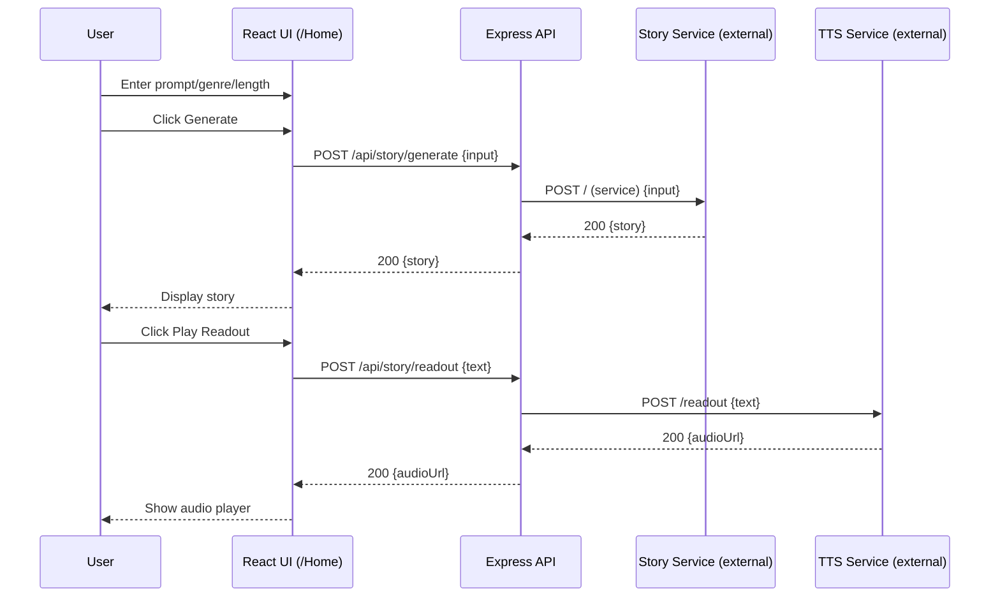

# KathaVachakAI — High-Level Design (HLD)

## 1. Goals
Support the approved enhancements without changing the core stack (React + Express + MongoDB):
1. Story generation UX completion
   - Display generated story text
   - Loading, success, and error states
   - Prevent invalid input and double submits
2. Replace hard-coded external URLs with configuration
   - Environment variables for endpoints
   - Prefer backend API boundary (optional proxy)
3. Authentication end-to-end
   - Signup/Login UI
   - JWT storage and route protection

## 2. Non-goals
- Changing the underlying story generation or TTS model implementation (not present in this repo).
- Introducing a new frontend framework or backend language.
- Implementing advanced auth features (refresh tokens, MFA) unless later required.

## 3. Assumptions (explicit)
- **Assumption A1:** The story-generation service returns JSON with a `story` field.
- **Assumption A2:** The readout service returns JSON with an `audioUrl` field.
- **Assumption A3:** The team will decide between direct frontend calls vs backend proxy; this HLD describes both patterns with a recommended default (backend boundary).
- **Assumption A4:** JWT will be stored client-side (localStorage or memory; decision pending).

## 4. Constraints (verified)
- Frontend is React with routes defined in `src/App.js`.
- Backend supports `/api/signup`, `/api/login`, `/api/protected` and uses JWT.
- CORS is currently fixed to `http://localhost:3000`.
- Existing story/TTS endpoints are hard-coded ngrok URLs in `src/Home.js`.

## 5. Main user journeys

### UJ-1: Browse books (existing)
1. User opens `/` and navigates to `/ReadBooks`.
2. User clicks a book cover to open a PDF.

### UJ-2: Generate and read a story (enhanced)
1. User navigates to `/Home`.
2. User enters prompt, selects genre, chooses length.
3. User clicks **Generate**.
4. UI shows **Generating…** and disables actions.
5. Generated story text is displayed.

### UJ-3: Listen to a story (enhanced)
1. After UJ-2, user clicks **Play Readout**.
2. UI shows **Creating audio…**.
3. Audio player appears and playback is possible.

### UJ-4: Sign up and log in (new end-to-end)
1. User navigates to `/signup`, creates an account.
2. User navigates to `/login`, authenticates.
3. JWT is stored; user can access protected routes.

## 6. High-level components

### 6.1 Frontend components
- `Front` (`/`): entry navigation.
- `ReadBooks` (`/ReadBooks`): static library.
- `Home` (`/Home`): story generation + readout.
- **Proposed:** `Login` (`/login`): login form.
- **Proposed:** `SignUp` (`/signup`): signup form.
- **Proposed:** `ProtectedRoute`: route guard for authenticated-only pages.
- **Proposed:** `authStore` / `authClient`: token storage + helpers.

### 6.2 Backend components
- Auth API (existing): signup/login/protected.
- **Proposed (if proxy approach):** Story API endpoints that forward to external services.
- MongoDB user store.

### 6.3 External services (existing dependency)
- Story generation service
- TTS readout service

## 7. Interfaces and request/response flow

### 7.1 Story generation
**Recommended (proxy) flow:**
- Frontend → `POST {API_BASE}/api/story/generate`
- Backend → forwards to external story service
- Backend → returns `{ story: string }`

**Alternative (direct) flow:**
- Frontend → `POST {STORY_SERVICE_URL}`

### 7.2 Readout (TTS)
**Recommended (proxy) flow:**
- Frontend → `POST {API_BASE}/api/story/readout`
- Backend → forwards to external TTS
- Backend → returns `{ audioUrl: string }`

### 7.3 Auth
- Signup: `POST {API_BASE}/api/signup` with `{ email, password }`
- Login: `POST {API_BASE}/api/login` with `{ email, password }` → `{ token }`
- Protected call: `GET {API_BASE}/api/protected` with `Authorization: Bearer <token>`

## 8. Mermaid sequence diagram (generate + readout; proxy option)

## 9. Auth flow (HLD)

### 9.1 Login
1. User submits email/password.
2. Frontend calls `/api/login`.
3. Backend returns JWT.
4. Frontend stores JWT and marks session authenticated.
5. Frontend redirects to `/Home`.

### 9.2 Protected routes
- If JWT missing/invalid, redirect to `/login`.

## 10. UX states

### 10.1 Loading
- Generate: show spinner/text, disable inputs and buttons.
- Readout: show spinner/text, disable readout button.

### 10.2 Success
- Story visible in a formatted container.
- Audio player visible when `audioUrl` present.

### 10.3 Empty
- Initial: no story shown; readout disabled.

### 10.4 Error
- Show inline error banner/messages.
- Provide a “Try again” path by re-enabling actions.

## 11. Security, privacy, and failure handling
- Do not store secrets in frontend.
- Use env vars for URLs.
- CORS should allow configured origins and include `Authorization` header.
- If external services fail:
  - show a user-friendly message
  - avoid leaking raw stack traces
  - optionally implement backend timeouts and limited retries

## 12. Acceptance criteria (functional + non-functional)

### Functional
- Story generation displays story text in UI.
- Loading and error states exist for generation and readout.
- No hard-coded external URLs remain in frontend.
- Signup/login UI works with existing backend endpoints.
- Protected route(s) redirect to login when unauthenticated.

### Non-functional
- Core flows work with configurable endpoints in dev and prod.
- API failures are recoverable without page refresh.
- Minimal security baseline: JWT in Authorization header, no keys in client.

## 13. Dependencies, risks, unresolved decisions
- Decide proxy vs direct external calls.
- Confirm story/TTS response schemas.
- Decide gmail-only signup rule.
- Decide token storage strategy.
- Confirm whether `/ReadBooks` remains public.
